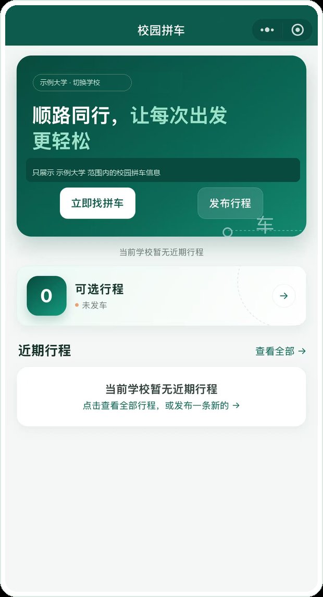
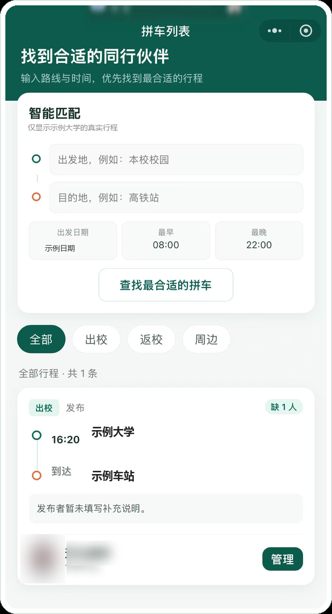
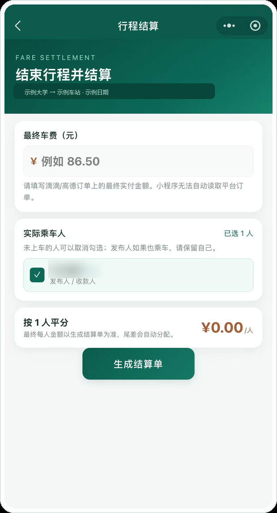

# 同校顺路 · 校园拼车小程序

<p align="center">
  
</p>

<p align="center">
  面向高校的校园拼车信息与组队小程序：按学校隔离、发布行程、加入拼车团、群内沟通、AA 结算。<br>
  A school-scoped campus carpool WeChat Mini Program built with native WXML/WXSS/JavaScript and WeChat Cloud Development.
</p>

> **项目状态：可运行原型，未完成上线合规。**
> 本项目用于技术学习、校园试点和产品验证，不是可以直接上架的成品。微信小程序平台目前不允许个人主体提供“拼车”类服务；中国大陆的校园拼车还涉及备案、运输合规、隐私政策和校园安全治理。请先阅读 [合规说明](docs/COMPLIANCE.md)，不要把它当成规避审核的方案。

## 目录

- [功能](#功能)
- [技术架构](#技术架构)
- [目录结构](#目录结构)
- [快速开始](#快速开始)
- [云函数与数据集合](#云函数与数据集合)
- [测试](#测试)
- [界面截图](#界面截图)
- [安全与隐私](#安全与隐私)
- [已知限制与路线图](#已知限制与路线图)
- [贡献](#贡献)
- [许可证](#许可证)

## 功能

- **按学校隔离**：首次进入从教育部普通高等学校目录选择学校；行程、拼车团和搜索都按学校标识码隔离。
- **行程发布与筛选**：出校 / 返校 / 周边，出发地、目的地、日期、时间、余座；发布后可在列表和首页直接加入。
- **发车状态**：出发后不能加入、退出或编辑；当天行程保留，次日 00:00 后过期；跨日保留 24 小时补结算窗口。
- **拼车团与群聊**：行程级临时群，成员可在小程序内沟通，不需要先加微信好友。
- **搭子关系**：通过 `CP-` 搭子码或群成员发起申请，对方同意后才建立关系；支持备注和双向删除。
- **AA 结算**：发布人填写最终车费，按实际乘车人平分；收款码仅结算成员可见，平台不代收、不抽成。
- **订阅消息**：仅用于“有人加入我的拼车团”提醒，发送前在事务内预扣额度，失败回补。
- **隐私最小化**：手机号、学号只保存在云端私有资料；手机号只向有效的搭子或活动拼车团成员返回；客户端不接触其他用户的 OPENID。
- **自动清理**：行程结束、取消、解散或过期后清理临时群、成员、消息和实时事件；`rides` 定时触发器每 10 分钟兜底。

完整的功能与决策记录见 [docs/PROGRESS.md](docs/PROGRESS.md)，部署细节见 [docs/CLOUD_SETUP.md](docs/CLOUD_SETUP.md)。

## 技术架构

```text
微信小程序（原生 WXML / WXSS / JS）
        │
        │  utils/cloud.js  callFunction()
        ▼
微信云函数（Node.js + wx-server-sdk）
  login / profile / social / chat / rides
        │
        │  cloud.getWXContext().OPENID
        ▼
云数据库 collections + 私有云存储
  users / rides / ride_members / buddies / ...
```

设计原则：

1. **客户端不传 OPENID**：云端身份只来自 `cloud.getWXContext()`。
2. **敏感写操作只走云函数**：数据库集合默认不对小程序端开放读写；唯一例外是 `chat_events` 的本人只读安全规则。
3. **不做本地降级**：云端失败时明确报错或显示空状态，不在本地伪造订单、成员或聊天。
4. **临时群随行程生命周期清理**：避免行程结束后仍能访问群聊。
5. **收款码最小暴露**：只向结算参与者和发布者返回临时地址，首页、列表、公开资料均不返回。

更完整的数据流、状态机和信任边界见 [docs/ARCHITECTURE.md](docs/ARCHITECTURE.md)。

## 目录结构

```text
.
├─ app.js / app.json / app.wxss        # 小程序入口与全局配置
├─ pages/
│  ├─ school-select/                    # 首次选校与换校
│  ├─ index/                            # 首页
│  ├─ rides/                            # 拼车列表与筛选
│  ├─ publish/                          # 发布行程
│  ├─ messages/                         # 对话、拼车团、搭子
│  ├─ chat/                             # 双人会话 / 群聊 / 加入拼车团
│  ├─ group/                            # 拼车团详情、成员、结算入口
│  ├─ settlement/                       # AA 结算
│  └─ ride-edit/                        # 编辑行程
├─ cloudfunctions/
│  ├─ login/                            # 登录与用户初始化
│  ├─ profile/                          # 资料、学校、头像、收款码
│  ├─ social/                           # 搭子申请与关系
│  ├─ chat/                             # 会话、消息、订阅额度
│  └─ rides/                            # 行程、成员、结算、过期清理
├─ utils/                               # 云调用、学校、手机号等客户端工具
├─ database/indexes.json                # 云数据库索引清单
├─ scripts/                             # 学校目录同步、索引初始化
├─ tests/run.js                         # 无依赖的静态与领域测试
└─ docs/                                # 部署、架构、合规、进度
```

## 快速开始

### 1. 准备

- 微信开发者工具（稳定版）
- 一个已开通云开发的微信小程序 AppID
- Node.js 18+（只用于跑测试和同步学校目录，不参与小程序构建）
- 微信云开发环境

```bash
git clone https://github.com/youlongcoming/tongxiao-shunlu.git
cd tongxiao-shunlu
```

### 2. 配置 AppID 与云环境

1. 用微信开发者工具导入本目录。
2. 在 `project.config.json` 中把 `appid` 换成你自己的小程序 AppID。
3. 在 `utils/cloud.js` 中把 `ENV_ID` 换成你的云环境 ID。
4. 如果使用订阅消息，在 `utils/config.js` 填入模板 ID，并在 `chat`、`rides` 云函数环境变量中设置 `CHAT_SUBSCRIBE_TEMPLATE_ID`；留空则关闭提醒。
5. 按需在云函数环境变量中配置 `MINIPROGRAM_STATE`：`developer` / `trial` / `formal`。

> 仓库使用 `touristappid`、`YOUR_CLOUD_ENV_ID` 和空模板 ID 作为占位符，不包含作者的真实配置；Fork 后请替换成自己的。

### 3. 创建云数据库

在云开发控制台创建以下集合，并设置为“仅云函数/管理端可读写”：

`users`、`rides`、`ride_members`、`buddy_requests`、`buddies`、`conversations`、`messages`、`chat_events`、`conversation_reads`、`subscriptions`

`chat_events` 是唯一的客户端只读集合，安全规则必须是：

```json
{
  "read": "auth.openid == doc.ownerOpenid",
  "write": false
}
```

索引按 [database/indexes.json](database/indexes.json) 创建，或先预览再执行：

```powershell
pwsh ./scripts/init-database-indexes.ps1 -EnvId "<your-env-id>" -Apply
```

### 4. 部署云函数

在微信开发者工具中依次右键以下目录，选择 **上传并部署：云端安装依赖**：

1. `cloudfunctions/login`
2. `cloudfunctions/profile`
3. `cloudfunctions/social`
4. `cloudfunctions/chat`
5. `cloudfunctions/rides`

`rides/config.json` 声明了每 10 分钟执行的定时触发器，用于过期行程兜底清理。部署后在云开发控制台确认触发器已生效。

### 5. 运行

重新编译小程序，首次进入先选择学校，然后在“我的”页保存资料、上传收款码，再测试发布、加入、群聊和结算。双账号验收步骤见 [docs/CLOUD_SETUP.md](docs/CLOUD_SETUP.md)。

## 云函数与数据集合

| 云函数 | 职责 |
| --- | --- |
| `login` | 从 `getWXContext()` 建立/更新用户，生成不暴露 OPENID 的 `CP-` 搭子码 |
| `profile` | 资料、学校、头像、私有收款码；学号仅本人可见；换校次数校验 |
| `social` | 搭子申请、接受/拒绝、备注、双向删除；群内申请校验共同行程 |
| `chat` | 双人会话、行程群聊、消息、已读、订阅额度 |
| `rides` | 行程发布/列表/加入/退出、结算、收款确认、过期清理、订阅通知 |

| 集合 | 用途 |
| --- | --- |
| `users` | 微信身份、私有资料、当前学校、收款码文件 ID |
| `rides` | 行程、拼车团、结算状态 |
| `ride_members` | 拼车团成员与角色 |
| `buddy_requests` | 搭子申请 |
| `buddies` | 双向搭子关系与备注 |
| `conversations` / `messages` | 双人会话与行程群聊 |
| `chat_events` | 客户端只读的实时事件投影 |
| `conversation_reads` | 已读位置 |
| `subscriptions` | 订阅消息授权额度 |

## 测试

项目没有 npm 运行时依赖。测试会检查：

- 所有 JSON 可解析
- `app.json` 注册页面四件套齐全
- WXML 事件绑定在页面 JS 中存在
- 私有页面已禁止索引
- 行程日期/时区/过期/发车判定
- 结算金额分配、成员权限等领域逻辑

```bash
node tests/run.js
# 全部自动化检查通过。
```

## 界面截图

截图中的头像、姓名、学校、路线、日期已做隐藏或替换处理；AA 页不展示收款码。

<p align="center">
  
  
  
</p>

## 安全与隐私

- 不提交 `AppSecret`、支付密钥、私钥、访问令牌、真实手机号或学号。
- 手机号只允许云函数向仍有效的搭子私聊对象或活动拼车团成员返回；不得进入公开资料、申请、成员列表或日志。
- 学号是选填的 4–20 位学校内部标识，仅保存在当前用户私有资料中。
- 收款码保存在私有云存储 `payment-codes/`，只向结算参与者返回临时地址。
- 上线前必须补齐：内容审核、举报/拉黑、账号注销与数据删除、管理员后台、应急预案。
- 如果发现安全问题，请不要开公开 issue，按 [SECURITY.md](SECURITY.md) 的方式私下报告。

## 已知限制与路线图

- [ ] 文字内容审核（`msgSecCheck`）与图片审核全覆盖
- [ ] 聊天/搭子申请频率限制与风控
- [ ] 举报、拉黑、管理员审核后台
- [ ] 账号注销、数据导出与删除流程
- [ ] 统一身份认证 / 学号校验（当前仅学校选择，不是强学籍认证）
- [ ] 历史 `seatsLeft` 漂移的巡检与修复脚本
- [ ] 小程序备案、主体资质与学校试点审批
- [ ] 更多学校的真实灰度与运营数据

> 微信个人主体目前无法选择“拼车”类目。要合法上线，通常需要学校/校属单位或企业主体完成备案，并按当地交通与校园管理规定接受指导。详见 [docs/COMPLIANCE.md](docs/COMPLIANCE.md)。

## 贡献

欢迎提交 issue 和 PR。开始前请阅读：

- [CONTRIBUTING.md](CONTRIBUTING.md)
- [AGENTS.md](AGENTS.md)
- [docs/PROGRESS.md](docs/PROGRESS.md)

本项目坚持原生小程序、零 npm 运行时依赖、云端身份只取 `getWXContext()`。提交前请运行 `node tests/run.js`。

## 许可证

[MIT](LICENSE) © 2026 同校顺路 contributors
